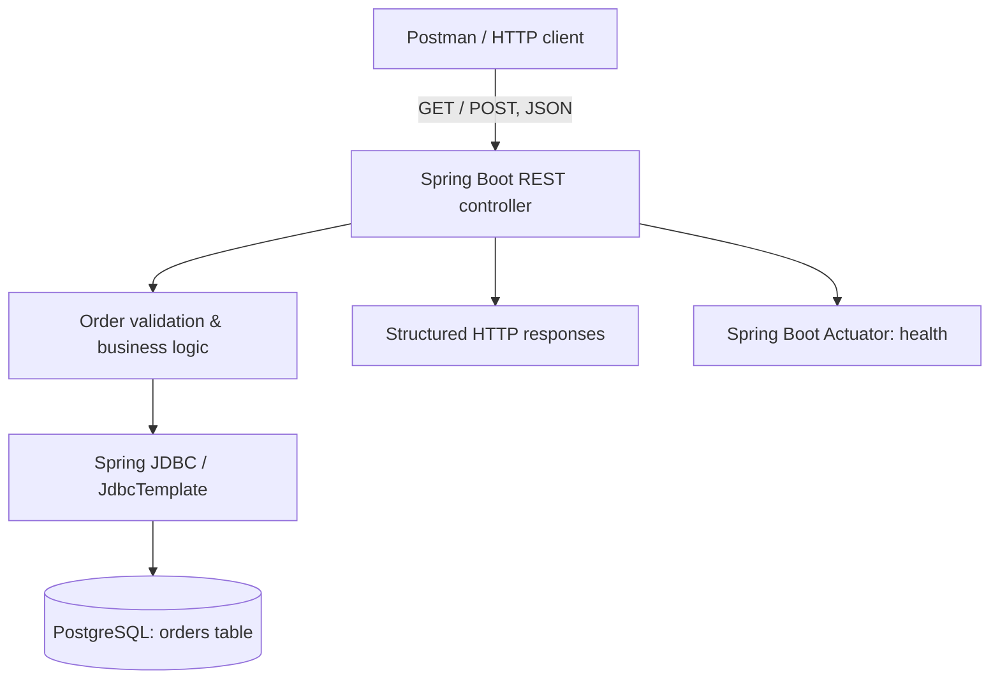

# PizzaOps — Java REST API with PostgreSQL

A learning and portfolio project that modernizes an introductory Java pizza-ordering console program into a small REST application with **Spring Boot**, **PostgreSQL**, and **API testing in Postman**.

The focus is on skills relevant to **Application Support / Technical Support Engineering**: troubleshooting HTTP requests, validating input, querying databases, examining failures, and documenting resolutions.

> **Status:** Java REST API and local PostgreSQL persistence manually verified. Local Postman requests (201, 200 and descriptive 400) were also verified. Automated test workflow is included; verify its result on GitHub after publishing.

## Features currently implemented

- `GET` endpoints for catalog, orders, one order, statistics, and health.
- `POST` endpoint to create an order from JSON.
- Input validation (required fields, known menu choices, duplicate toppings).
- Structured HTTP error responses, including invalid field and allowed values.
- Persistent orders stored in PostgreSQL via Spring JDBC (`JdbcTemplate`) with JSONB toppings.
- JUnit / Spring MVC automated tests configured with an isolated in-memory test service.
- Postman collection with positive and negative test examples.
- CLI program preserved separately; its orders remain in-memory.

## Architecture



More details: [Architecture](docs/architecture.md).

## Technology stack

- Java 21
- Spring Boot 3.5.x, Maven
- Spring Web, Bean Validation, Spring JDBC and Actuator
- PostgreSQL 18, SQL, JSONB
- Postman, JUnit 5, Spring MVC testing
- GitHub Actions workflow included (validate its status after publishing)

## Run locally on Windows

Prerequisites: **JDK 21** and **PostgreSQL** running on `localhost:5432`.

1. Create a PostgreSQL database named `pizzaops`.
2. Run the included [`sql/schema.sql`](sql/schema.sql) in pgAdmin (connected to `pizzaops`).
3. Open the project root in VS Code.
4. In a PowerShell terminal, start the API:

   ```powershell
   .\scripts\run-api.ps1
   ```

   The script asks for the PostgreSQL password when needed. **Never put it into source files, screenshots, commits or documentation.**
5. Look for `Started PizzaOpsApplication`. The API listens on `http://localhost:8080`.

### Example API request

```http
POST http://localhost:8080/api/v1/orders
Content-Type: application/json
```

```json
{
  "size": "LARGE",
  "base": "THIN",
  "sauce": "BARBEQUE",
  "cheese": "MOZZARELLA",
  "toppings": ["PEPPERONI", "HAM", "OLIVES", "MUSHROOM"]
}
```

Expected response: `201 Created`, with an order ID. To retrieve it:

```http
GET http://localhost:8080/api/v1/orders
```

In pgAdmin, verify persistence:

```sql
SELECT id, size, base, toppings, created_at
FROM orders
ORDER BY id DESC;
```

Stop/restart the Spring Boot API and run the `GET` again. Persisted records should remain.

## API routes

| Method | Endpoint | Purpose | Typical success status |
|---|---|---|---|
| GET | `/api/v1/menu` | Available catalog options | 200 |
| POST | `/api/v1/orders` | Create an order | 201 |
| GET | `/api/v1/orders` | List orders | 200 |
| GET | `/api/v1/orders/{id}` | Retrieve one order | 200 |
| GET | `/api/v1/statistics` | Summary of confirmed orders | 200 |
| GET | `/actuator/health` | Application health | 200 |

**Note:** Order updates (`PUT`) and deletes (`DELETE`) are **not implemented**.

## Negative testing / diagnostics

Sending an invalid catalog value, such as `"size": "EXTRA_GIGANTE"`, returns `400 Bad Request` with an actionable error:

```json
{
  "status": 400,
  "error": "INVALID_CATALOG_VALUE",
  "field": "size",
  "allowedValues": ["SMALL", "MEDIUM", "LARGE"]
}
```

The actual response also contains a timestamp, explanation and request path. An invalid request does not insert a new order.

See [API test cases](docs/api-testing.md) and [real troubleshooting cases](docs/troubleshooting.md).

## Automated tests

On Windows:

```powershell
.\scripts\test-api.ps1
```

The automated API tests use a `test` profile with in-memory storage. They **do not** validate integration against a live PostgreSQL instance; manual Postman + pgAdmin checks were used for that. The GitHub Actions workflow runs Maven tests on each push and pull request.

## Project boundaries / next steps

This is a portfolio learning project, **not** a production-ready ordering platform. It currently has **no user authentication, RBAC, cloud deployment, frontend, schema migrations or automated live-PostgreSQL integration tests**. Planned improvements include a dedicated least-privileged database user, DB integration tests and operational logging.

## Background

Started as a basic console project in a university programming module and rebuilt as a separate modern Java application. This repository documents the refactoring and subsequent features. It is **a personal learning project**, not a claim of professional Java engineering employment.
