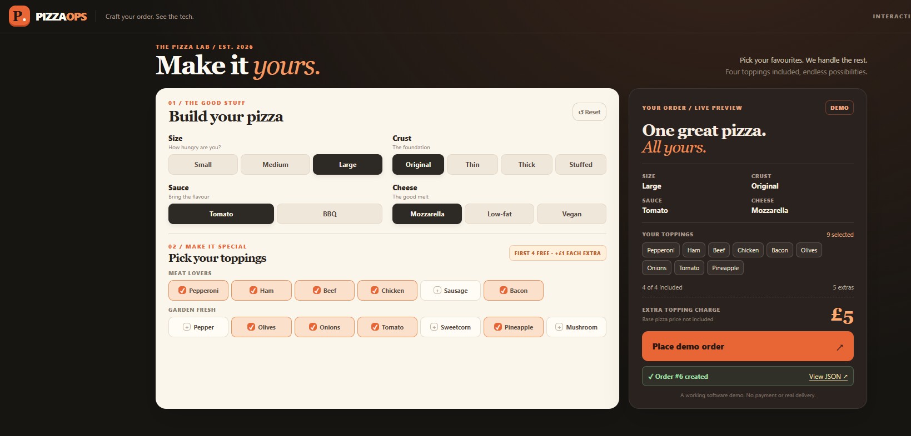
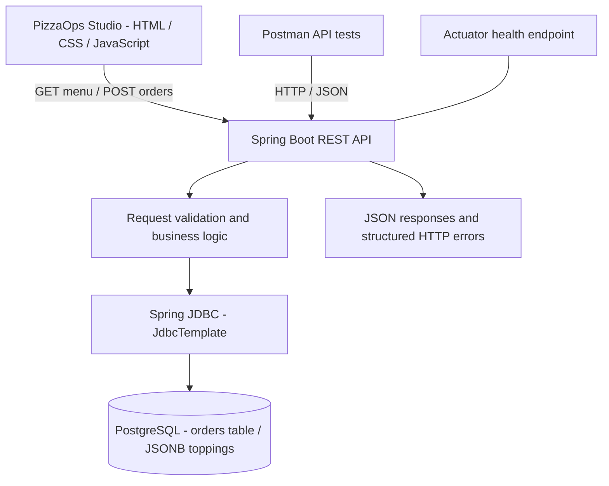
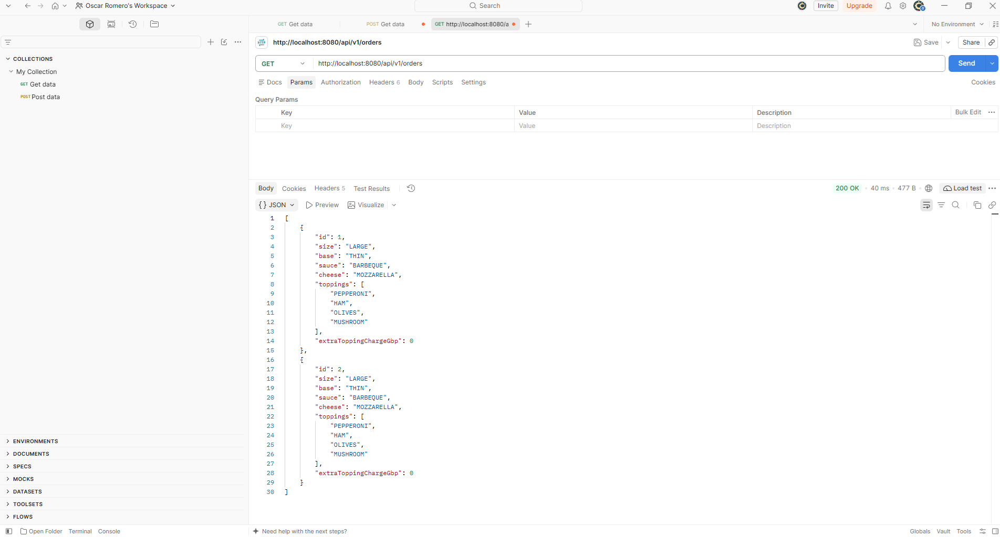
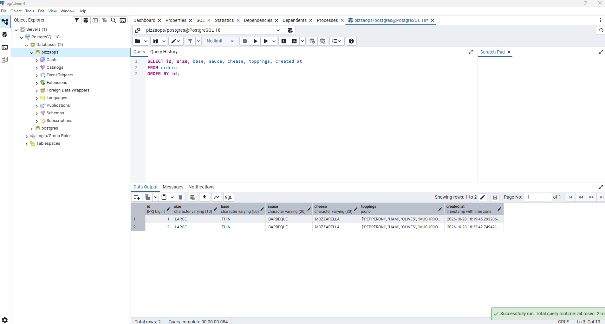

# PizzaOps — Java REST API & Pizza Ordering Studio

A full-stack learning and portfolio project built with **Java 21, Spring Boot, PostgreSQL, HTML, CSS, and JavaScript**. PizzaOps transforms an introductory university console application into an interactive pizza-ordering demo backed by a REST API and a relational database.

The project focuses on practical skills relevant to **Application Support, Production Support, Technical Operations, and Technical Support Engineering**: working with HTTP APIs, validating requests, investigating errors, querying SQL data, testing integrations, and documenting incidents.

> **Current status:** Responsive web interface running locally; order creation and PostgreSQL persistence manually verified. **9 automated tests passing** (0 failures, 0 errors) in the latest local Maven run. Public cloud deployment is not yet available.

## PizzaOps Studio — Web Interface



The browser-based demo lets users:

- Select a pizza size, crust, sauce, and cheese from the live API catalog.
- Choose from 13 toppings, grouped into meat and vegetable options.
- See a live order summary and topping charges before submitting.
- Create a demo order via `POST /api/v1/orders` and open its JSON response using the generated order ID.

**Pricing scope:** The first four toppings are included; each additional topping adds **£1**. Base pizza prices, payments, and deliveries are **not implemented**. This is a technical demo, not a commercial ordering service.

## Architecture



Spring Boot also serves the frontend assets from `src/main/resources/static/`, so the local web interface and API run on the same origin.

More detail: [Architecture documentation](docs/architecture.md).

## Technology Stack

| Area | Technologies |
| --- | --- |
| Backend | Java 21, Spring Boot 3.5.x, Maven |
| Web frontend | HTML, CSS, vanilla JavaScript |
| REST API | Spring Web, Bean Validation, JSON |
| Database | PostgreSQL, SQL, Spring JDBC (`JdbcTemplate`), JSONB |
| Diagnostics | Spring Boot Actuator, structured HTTP error responses |
| Testing | JUnit 5, Spring MVC / MockMvc, Postman |
| CI | GitHub Actions — Maven verification on push and pull request |

## Run Locally (Windows)

**Prerequisites:** JDK 21 and a local PostgreSQL server accessible at `localhost:5432`.

1. Create a PostgreSQL database called `pizzaops`.
2. Run [`sql/schema.sql`](sql/schema.sql) against that database using pgAdmin or another PostgreSQL SQL client.
3. Open this repository's root directory in VS Code.
4. Start the application in PowerShell:

   ```powershell
   .\scripts\run-api.ps1
   ```

5. Enter the PostgreSQL password if prompted. Do **not** store credentials in source files, screenshots, commits, or documentation.
6. When the terminal shows `Started PizzaOpsApplication`, open **http://localhost:8080/**.

The application runs locally on port `8080`. Leave the server terminal open while testing the demo.

### Run Automated Tests

From the repository root:

```powershell
.\scripts\maven.ps1 verify
```

**Latest verified local result (16 November 2026):**

```text
Tests run: 9, Failures: 0, Errors: 0, Skipped: 0
BUILD SUCCESS
```

These tests use the isolated Spring `test` profile and an **in-memory service**, not a live PostgreSQL database. Database persistence has been checked separately with manual API requests and SQL queries. The [GitHub Actions workflow](.github/workflows/ci.yml) runs Maven verification on pushes and pull requests.

## REST API Endpoints

| Method | Endpoint | Purpose | Typical status |
| --- | --- | --- | --- |
| `GET` | `/api/v1/menu` | Read pizza options | `200` |
| `POST` | `/api/v1/orders` | Create an order | `201` |
| `GET` | `/api/v1/orders` | List saved orders | `200` |
| `GET` | `/api/v1/orders/{id}` | Retrieve a specific order | `200` |
| `GET` | `/api/v1/statistics` | Read order statistics | `200` |
| `GET` | `/actuator/health` | Basic application health endpoint | `200` when healthy |

`PUT` and `DELETE` order endpoints are **not implemented**.

### Example: Create an Order

```http
POST /api/v1/orders HTTP/1.1
Content-Type: application/json
```

```json
{
  "size": "LARGE",
  "base": "THIN",
  "sauce": "BARBEQUE",
  "cheese": "MOZZARELLA",
  "toppings": ["PEPPERONI", "HAM", "OLIVES", "MUSHROOM"]
}
```

A valid request returns **`201 Created`**, the new order data, and a `Location` response header. Retrieve the saved order with `GET /api/v1/orders/{id}`.

Check the database directly:

```sql
SELECT id, size, base, toppings, created_at
FROM orders
ORDER BY id DESC;
```

Saved orders remain available after restarting Spring Boot, as long as the same PostgreSQL database is used.

## Troubleshooting & Negative Testing

PizzaOps validates required fields, catalog selections, and duplicate toppings. For example, an unknown pizza size returns **`400 Bad Request`** with the invalid field and the allowed values:

```json
{
  "status": 400,
  "error": "INVALID_CATALOG_VALUE",
  "field": "size",
  "allowedValues": ["SMALL", "MEDIUM", "LARGE"]
}
```

*Shown above is an excerpt of the error payload; the actual response also includes additional diagnostic fields.* Invalid requests do not create orders.

A practical failure investigated during development was **`FATAL: password authentication failed for user "postgres"`**, which caused HTTP `500` on order submission. The issue was traced to an incorrect database password in the local environment, corrected without changing the frontend or API logic, and verified by successfully creating another order.

Read more:
- [API test cases and Postman checks](docs/api-testing.md)
- [Troubleshooting notes](docs/troubleshooting.md)
- [Postman collection](postman/PizzaOps_2_0.postman_collection.json)

**Operational note:** A healthy application endpoint alone does not prove that PostgreSQL credentials or order persistence work. Validate the database path with an actual order request and SQL query.

## Evidence — API & Database

### REST API — Postman



### PostgreSQL — Persistent Orders



## Limitations & Roadmap

PizzaOps is a **personal learning and portfolio project**, not a production-ready service. It currently has no authentication or role-based access control, payment processing, public cloud deployment, database schema migration system, or automated integration tests against a live PostgreSQL instance.

Potential next steps include **Docker-based deployment, a free public demo, stronger operational logging/monitoring, a least-privileged database account, and PostgreSQL integration tests**. These are planned improvements, **not completed features**.

## Project Background

PizzaOps began as an introductory university Java console program and was progressively rebuilt as a separate Spring Boot project. The original CLI was preserved in the repository's legacy material; it uses in-memory state rather than PostgreSQL.

All work documented here is **personal project experience**, not a claim of professional Java engineering employment.
